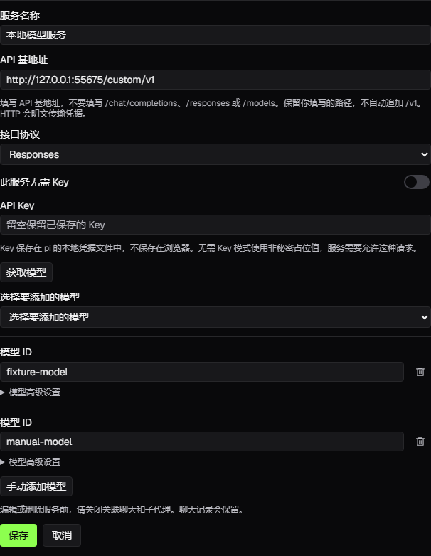
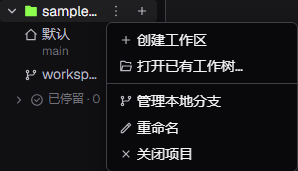
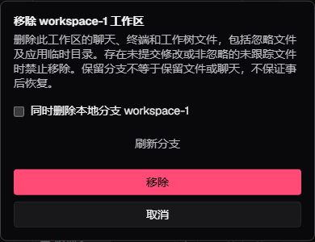
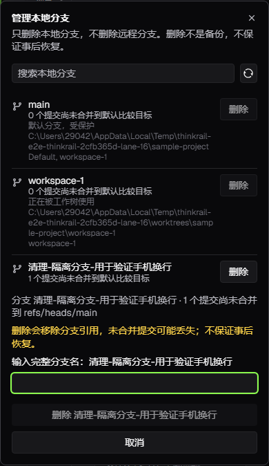

# ThinkRail

基于 [`JetBrains/thinkrail`](https://github.com/JetBrains/thinkrail) 的中文增强版本，围绕
[`pi`](https://www.npmjs.com/package/@earendil-works/pi-coding-agent) 编程代理构建。
在同一个工作台中管理项目、聊天、终端、文件与代码差异，用规格文档和可复用技能保留项目知识。

本仓库提供简体中文默认界面、多服务 OpenAI 兼容接入，以及可直接安装的 Windows x64 桌面包。
这是基于上游源码的定制版本，不是 JetBrains 官方签名发行版；内置提供商与 pi 引擎保持原有体系。

## 功能

- **中文界面**：新配置默认使用简体中文，保留英文和“跟随系统”；不覆盖已有明确语言偏好。
- **自定义模型服务**：配置多个 API 基地址、Key 和模型列表，分别选择 Chat Completions 或 Responses。
- **独立工作区**：使用 Git worktree 隔离分支与工作目录，也可在项目文件夹或已有 worktree 中工作。
- **流式聊天与子代理**：同一工作区内运行多个 pi 会话，选择模型、查看引擎报告的 token 与费用、发送后续任务。
- **代码工作台**：文件树、Monaco 编辑器、终端、差异查看与锚定审查评论，支持打开已安装的 IDE。
- **项目知识**：通过 `SPEC.md` 规格图、技能和工作流管理持久上下文，而不是另建一套模型运行系统。
- **MCP 与扩展**：复用 pi 的 MCP 配置和扩展能力，在设置中管理服务、认证与项目授权。
- **桌面与浏览器**：原生桌面应用和 CLI 共用同一宿主与界面；应用状态通常位于 `~/.thinkrail`。

## Windows 安装

无需自行安装 Bun、Node.js 或项目依赖即可使用随附的桌面包；项目操作仍需要可用的 Git，
模型账号与凭据由用户自行配置。界面使用系统 WebView2，缺少运行时时需要补装。

1. 从[本仓库的最新正式 Release](https://github.com/52zyd/ThinkRail/releases/latest) 下载 `thinkrail-desktop-windows-x64.zip`。
2. **完整解压**压缩包，不要在压缩包预览中直接运行程序。
3. 在解压目录中双击 `ThinkRail-Setup.exe`，按提示安装。必须保留旁边的 `.installer` 文件夹。
4. 已安装 ThinkRail 的用户，先退出应用并备份个人配置与聊天记录。本包沿用原项目的应用标识，不保证与官方版本并存。

本机仓库中的 `bytools/ThinkRail-Setup.exe` 也可直接启动安装，前提是配套载荷保持在原位置。
分发时发送完整 ZIP，不要单独发送 EXE。

社区安装包**未签名**。Windows 可能显示发布者未知或
SmartScreen 警告，请核实来源后自行决定是否运行，不需要关闭系统安全防护。
同一 Release 中的 `SHA256SUMS` 用于检查完整性，不代替代码签名或来源认证：

```powershell
Get-FileHash .\thinkrail-desktop-windows-x64.zip -Algorithm SHA256
```

将输出与 `SHA256SUMS` 中对应文件的值比较。正式包由手动 Windows 发布流程构建，
通过 Linux 全量单元测试、Windows 原生与路径检查、完整无真实模型浏览器套件，以及 CLI、
桌面和安装包冒烟后才上传。构建来源与验证结果见对应 Release 的
[Actions 记录](https://github.com/52zyd/ThinkRail/actions/workflows/release-windows.yml)。

**更新来源**：本版本的桌面更新与 CLI 安装脚本仅使用
[`52zyd/ThinkRail`](https://github.com/52zyd/ThinkRail/releases)，不回退上游。
初始稳定版本为 `0.1.0`；正式包与校验和以版本 Release 为准，`bytools/` 保留本地交付副本。
桌面更新清单与载荷发布在独立的 `desktop-updates` Release。同为 `0.1.0` 的本地构建不会
收到同版本升级提示；需要正式构建时，手动安装完整 Release ZIP。
旧安装包仍内嵌上游更新地址，必须手动重装本仓库的新完整 ZIP 后才能迁移；个人数据不会自动删除。
macOS 和 Linux 可从源码自行构建；本仓库不宣称提供这些平台的已验证签名包。

## 接入 OpenAI 兼容服务

打开 **设置 → 提供商 → OpenAI 兼容服务**，选择添加服务。

| 配置项 | 填写说明 |
| --- | --- |
| 服务名称 | 用于区分不同服务，不覆盖内置提供商 |
| API 基地址 | 例如 `https://api.example.com/v1`；填写基地址，不要填写完整的 `/chat/completions` 或 `/responses` 地址 |
| 接口协议 | 默认 Chat Completions；需要 Responses 时显式选择，不会在失败后自动切换 |
| API Key | 按服务要求填写；编辑时留空保留已有 Key，明确开启“此服务无需 Key”才清除凭据 |
| 模型 ID | 至少一个，使用服务实际支持的完整 ID；可手动添加多个模型 |
| 模型高级设置 | 可填写上下文、最大输出上限，以及推理和图像能力；留空使用 pi 默认值，不按模型名称猜测 |

点击“获取模型”时，宿主访问基地址下的 `/models`，使用表单中的 Key 或该服务已保存的 Key。
返回的模型可选择加入列表。获取失败会保留表单和已有模型，也始终允许手动输入；
失败不等于该服务的聊天接口不可用。

页面顶部提供高亮的推荐兼容服务预设，可预填服务名称和 API 基地址；仍需填写自己的 Key
并选择或手填模型。打开预设不会连接服务或保存配置，官网链接仅在点击时打开。

保存后自定义模型进入现有模型选择器，**不会自动切换当前聊天或默认模型**。
修改服务前先关闭使用它的关联聊天与子代理，删除时也一样；聊天记录保留。
更换端点或协议会生成新的服务身份，需要重新选择对应模型。

注意以下边界：

- 基地址允许 HTTP/HTTPS，包括本机与局域网；用户提供的路径会保留，不自动追加 `/v1`，拒绝 URL 中的账号密码。
- “无需 Key”只适用于不要求鉴权的服务，内部使用非秘密占位值，不代表可以绕过远端鉴权。
- 真实 Key 通过 pi 的本地凭据接口保存，不返回给读取接口，也不保存到浏览器；没有新增加密保险库。
- HTTP 会明文传输凭据。除可信本机或受控网络服务外，优先使用 HTTPS。
- 未填写的模型上限与默认价格不是服务的真实承诺；不要据此判断请求免费或模型能力。
- 实际端点、协议和模型是否兼容仍需用你的服务实测，文档不承诺第三方服务质量、价格或可用性。



## 子智能体与本地分支清理

子智能体的 `Agent` 调用省略 `model` 时继承父聊天的当前模型；空字符串和纯空白也按省略处理。
显式选择推荐填写完整 `provider/id`，可附加 `:thinking` 推理级别；代理定义中的非空固定模型优先。
非空但无效或有歧义的模型引用仍会报错，不会悄悄换模型，也不改变父聊天的模型。

**工作区菜单 → 移除工作区** 可回收应用创建的 Git worktree，并清理其聊天和应用记录。
“同时删除本地分支”默认不勾选；保留分支不等于保留工作树文件或聊天。
有暂存修改、未暂存修改或非忽略的未跟踪文件时，宿主会拒绝回收；忽略文件和应用临时目录会随工作树删除。
项目主目录不可移除，外部 worktree 只解除应用关联，其目录和分支保留。

**点击项目名称旁的菜单按钮 → 管理本地分支** 可搜索并清理此前遗留的本地分支，也可右键项目名称打开同一菜单。
列表显示默认比较目标、未合并提交数、工作树占用和保护原因。默认分支、被工作树使用的分支、
仍被其他工作区或比较目标引用的分支不能删除。分支或比较目标变化后需要刷新并重新确认。
未合并分支必须输入完整分支名才能删除；这些提交可能丢失，不承诺事后恢复。
回收失败会保留工作区记录和聊天历史；工作树已回收但分支删除失败时会明确提示保留的分支。
此功能不切换分支，不删除远程分支，不批量强删，也不运行 Git 垃圾回收；旧宿主隐藏新入口。






## 语言设置

在 **设置 → 语言** 中选择简体中文、英文或跟随系统，设置会在重启后保留。
已有配置明确选择英文时不会被强制改成中文；新配置及缺少语言字段的配置默认中文。

界面翻译不改变模型回复语言，不翻译用户内容、终端输出、代码、模型 ID 或第三方错误原文。
自定义语言文件可放在 `~/.thinkrail/locales`；语言包与占位符规则见
[`packages/locales/SPEC.md`](packages/locales/SPEC.md)。

## 从源码运行与打包

开发环境需要 **Bun 1.4.4**、**Node.js ≥ 22.19** 和 Git。运行真实代理任务还需要可用的模型服务。
依赖版本按仓库锁定，不需要顺带升级 pi 或其他依赖。

```bash
git clone https://github.com/52zyd/ThinkRail.git
cd ThinkRail
bun install --frozen-lockfile
bun run dev
```

`bun run dev` 同时启动宿主与 Web 界面，按 `Ctrl+C` 停止。

```bash
bun run --filter @thinkrail/cli dev  # 在浏览器中打开应用
bun run build:binary               # 构建独立 CLI
bun run desktop:dev                # 打包并打开原生桌面应用
bun run desktop:build              # 仅构建开发版桌面应用
bun run desktop:package:stable     # 构建当前平台的安装包
```

Windows 打包输出在 `apps/desktop/artifacts/`，不会自动更新 `bytools/`。
发布新的 Windows 包时，需要一起替换完整的安装载荷、ZIP、说明和校验文件。
详细开发流程、正式测试、打包及隔离要求见 [`CONTRIBUTING.md`](CONTRIBUTING.md)。
项目测试源码保留在仓库中；本机调试脚本、依赖缓存、日志、报告和临时截图不属于发布内容。

## 架构与文档

ThinkRail 是薄宿主，pi 在进程内运行并管理模型、技能、压缩、费用与会话状态。
桌面与 CLI 只负责启动同一个宿主，不引入第二套代理运行时。

| 模块 | 职责 |
| --- | --- |
| `packages/server`、`packages/shared` | 引擎宿主、工作区与服务端状态 |
| `packages/contracts` | 类型化、版本门控的宿主与界面协议 |
| `apps/web` | React、Zustand、Tailwind 工作台界面 |
| `apps/desktop`、`apps/cli` | 原生桌面与浏览器启动器 |
| `packages/locales` | 界面语言包 |

- [产品目标与需求](goal-and-requirements.md)
- [架构与模块边界](architecture.md)
- [pi 兼容性记录](pi-compatibility.md)
- [贡献与验证指南](CONTRIBUTING.md)
- [上游项目](https://github.com/JetBrains/thinkrail)

## 隐私与凭据

此二开版本不发送应用使用统计、错误报告或浏览器来源归因，不再提供隐私分析开关与同意弹窗。
本地日志、崩溃记录和界面错误恢复保留。旧分析设置读取时忽略，并在下次保存配置时移除；
已有历史文件不会被批量清理。应用仍需要访问你主动配置的模型服务、MCP 服务和本仓库更新源。
这不意味着离线运行，也不限制用户自行安装的第三方扩展所发起的网络请求。
不要将 API Key、个人配置或包含敏感内容的本机日志提交到 Git。

## 许可证

本仓库沿用上游的 [Apache License 2.0](LICENSE)。原项目版权与许可证声明保持不变；
社区参与规则见 [Code of Conduct](CODE_OF_CONDUCT.md)。
